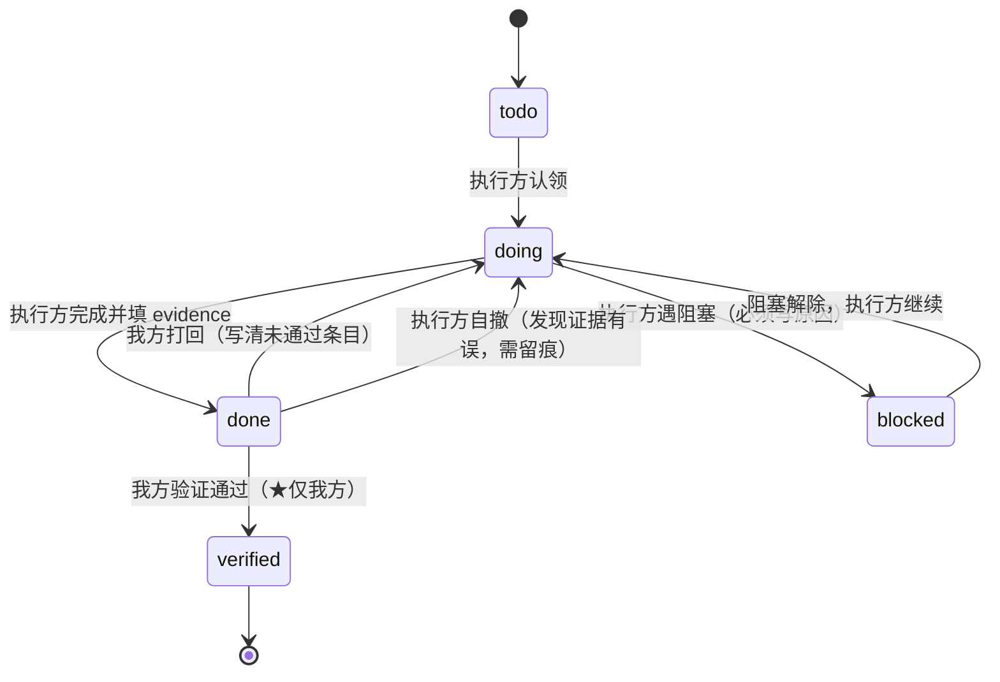
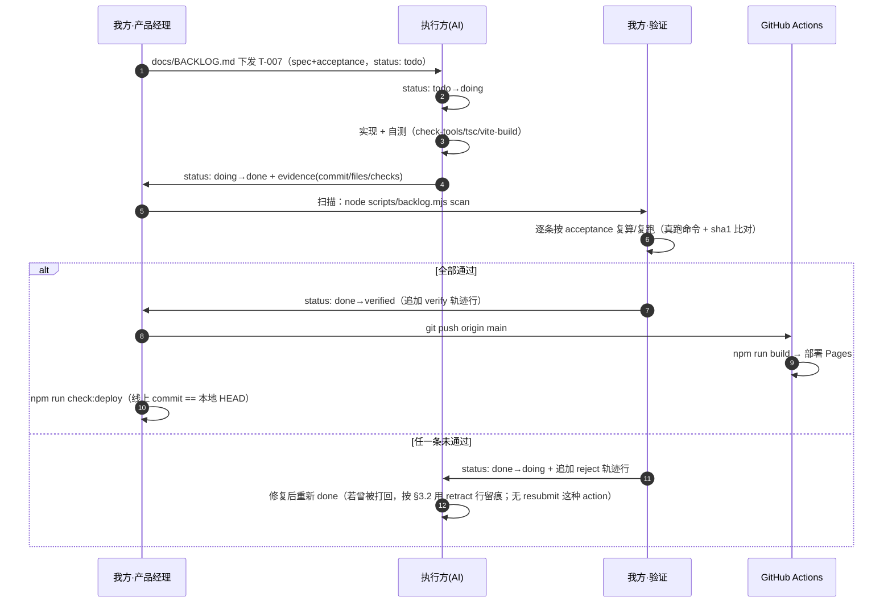

# AI 交接协议（AI-HANDOFF）

> 目的：团队不再直接写代码。工作模式改为 **调研 → 拆工作项（清单）→ 交给另一个 AI 工具实现 → 我方独立验证 → 部署**。
> 本文件定义**交接协议**（角色、状态机、证据规范、扫描/验证/部署流程、CLI 契约、纪律、开场白）。
> 任务清单**内容**由 `docs/BACKLOG.md` 承载（产品经理维护），本文件不重复其内容。
> 关联：`docs/BACKLOG.md`、`docs/TOOLS-LAYOUT.md`、`.github/workflows/deploy.yml`。

---

## 1. 角色与铁律（最重要）

### 1.1 双方分工

| 角色 | 是谁 | 负责 |
|---|---|---|
| **我方（团队）** | 本项目团队（team-lead 及各成员） | 调研、拆任务、**定协议**、**独立验证**、**部署**、写 `verified` |
| **执行方** | 另一个 AI 工具（外部） | 实现、自测、填 `evidence`、把 `status` 推到 `doing`/`done` |

### 1.2 一级铁律（醒目）

> ## ⛔ 铁律一：`verified` 只有我方可以写。
> **执行方永远不得把 `status` 写成 `verified`。** 执行方只能写 `doing` / `done` / `blocked`。
>
> 理由：**「自己批自己的作业」会让整个交接失去意义**。`done` 只表示"执行方自认为完成"，
> 它**不等于**"已验证"；只有我方按 `acceptance` 独立复算/复跑通过后，才升级为 `verified`。

> ## ⛔ 铁律二：`acceptance` 是我方验证的唯一依据。
> 执行方不得修改 `spec` / `acceptance` / `id` / `priority` / `area` / `depends` / `size` —— 这些是**我方**的写入面。

> ## ⛔ 铁律三：一次只做一个任务（或依赖允许的连续几个），不混 commit。

> ## ⛔ 铁律四：判断"要不要重做"只看**内容 sha1**，不用 mtime / 文件大小 / 文件是否存在这类代理指标。
> （本项目已有实测教训：edge-tts 输出重新合成后大小可能不变、内容却变，见 `docs/TOOLS-LAYOUT.md §6.3`。）

### 1.3 写入权限矩阵

| 字段 | 执行方可写 | 我方写 |
|---|---|---|
| `status` | ✅ 但仅限 `doing`/`done`/`blocked` | ✅ 含 `verified`、打回 |
| `evidence` | ✅ | ✅（验证留痕、打回原因） |
| `spec`/`acceptance`/`id`/`priority`/`area`/`depends`/`size` | ❌ 只读 | ✅ |

---

## 2. 状态机



### 2.1 迁移触发条件与权限

| # | 迁移 | 触发条件 | 谁有权 | 必填写入 |
|---|---|---|---|---|
| 1 | `todo → doing` | 执行方认领并开始 | 执行方 | `status: doing` |
| 2 | `doing → done` | 实现完成，自测通过 | 执行方 | `status: done` + `evidence`（单行，见 §3） |
| 3 | `doing → blocked` | 缺信息/依赖未就绪/超出权限 | 执行方 | `status: blocked` + `evidence` 的 `note=` 写清阻塞点 |
| 4 | `blocked → doing` | 阻塞解除 | 执行方 | `status: doing`（阻塞原因保留在 `evidence` 的 `note=`；如需留痕用 `retract` 行） |
| 5 | `done → verified` | 我方按 `acceptance` 逐条复算/复跑**全部通过** | **我方（唯一）** | `status: verified` + 轨迹行 `  - verify <ISO> | by=<验证者> | <结论>` |
| 6 | `done → doing`（**打回**） | 我方任一条 `acceptance` 未通过 | **仅我方** | `status: doing` + 轨迹行 `  - reject <ISO> | <条目> 未通过：<原因>` |
| 7 | `done → doing`（自撤） | 执行方发现证据有误/需补充 | 执行方 | `status: doing` + 轨迹行 `  - retract <ISO> | <原因>` |

> 轨迹行的精确格式与权限见 **§3.2**（格式已写死为可正则解析，`action` 仅 `verify`/`reject`/`retract`）。

### 2.2 打回的精确定义（回答团队疑问）

- **打回时执行方改哪个字段**：我方把 `status` 改回 **`doing`**，并在 `evidence` 下追加**一行轨迹**（格式见 §3.2）：
  ```
    - reject 2026-10-15T18:40:00+08:00 | acceptance 第 2 条不通过：首页未出现「集合」区块
  ```
  **不删除**执行方原有的 `evidence` 主行（保留原始证据，便于对照）。
- **是否允许执行方把 `done` 改回 `doing`**：**允许**（第 7 条自撤），但**必须留痕**：
  追加 `  - retract <ISO> | <原因>`，且不得因此获得任何"绕过验证"的能力（`verified` 仍只有我方写）。
- **多次往返**：每次打回/自撤各追加一行轨迹，按时间顺序排列，形成可追溯时间线。

---

## 3. `evidence` 字段规范

### 3.1 主证据行（执行方写，**单行、键值对、` | ` 分隔**）

```
evidence: commit=<hash> | files=<paths> | checks=<name:result,...> | deviation=<...> | note=<...>
```

| 键 | 必填 | 取值 | 说明 |
|---|---|---|---|
| `commit` | ✅ | 7~40 位十六进制 | 该任务提交的 commit（短 hash 或全 hash） |
| `files` | ✅ | 仓库相对路径，逗号分隔 | 本次改动/新增的文件，如 `src/data/collections.ts,public/tools/.../index.html` |
| `checks` | ✅ | `名:结果` 逗号分隔，结果为 `pass`/`fail` | 执行方**自己跑过**的校验命令及结果。建议名：`check-tools`、`tsc`、`vite-build`、`manual:<说明>`。无自动校验时写 `manual:<做了什么>`；确实没跑写 `none` |
| `deviation` | ⬜ | 自由文本（**不得含 ` \| `**） | 任何偏离 `spec` 的地方；无则省略 |
| `note` | ⬜ | 自由文本（**不得含 ` \| `**） | 一句话补充；`blocked` 时在此写阻塞原因 |

**取值约束**：单个 value **不得包含 `|`、换行**。需要分隔时用 `;`。值内可含 `=`（按**第一个** `=` 切分键值）。

**示例（合规）**
```
evidence: commit=a1b2c3d | files=src/data/tools/english/jiben-write.ts,public/tools/english/jiben-write/index.html | checks=check-tools:pass,tsc:pass,vite-build:pass | note=新增《基本英文100》默写工具
```
**示例（无自动校验，手验）**
```
evidence: commit=9f8e7d6 | files=docs/x.md | checks=manual:人工核对清单字段与格式 | deviation=acceptance#3 暂以截图代替自动化断言
```

### 3.2 轨迹行（留痕，**缩进恰好 2 空格 + `- `**，可多行，可正则解析）

紧跟在 `evidence` 主行之后。**格式写死为可正则解析**：

```
  - <action> <ISO8601> | <自由文本>
```

| 规则 | 要求 |
|---|---|
| 缩进 | **恰好 2 个空格** + `- `（与 `acceptance` 的顶级 `- `**严格区分**；多一个空格即非法） |
| `action` | **只能取** `verify` / `reject` / `retract` 三者之一；**大小写敏感、一律小写** |
| 时间 | ISO8601（建议带时区，如 `2026-10-14T18:40:00+08:00`） |
| 分隔 | `action` 与时间之间用 1 个空格；时间与自由文本之间用 ` | `（前后各一空格） |
| 自由文本 | 可含任意字符，**但不得换行** |
| 权限 | `verify`、`reject` **只有我方写**；`retract` **只有执行方写**（执行方自撤 `done`，或被我方打回后留痕） |
| 主行 | `evidence:` 主行必须保持**单行**、` | ` 分隔的键值格式，**不得换行** |

> 解析规则：`evidence:` 行取**机器字段**；其后的 `^  - ` 行是**轨迹**，扫描器可选读、不参与主行字段解析。

**完整示例（含主行 + reject + retract + 最终 verify，照此抄写）：**
```
evidence: commit=abc1234 | files=src/x.ts | checks=check-tools:pass,tsc:pass | note=偏离 spec：未改 y.ts
  - reject 2026-10-14T18:40:00+08:00 | acceptance 第 2 条不通过：/tools 页仍有 console error
  - retract 2026-10-14T19:05:00+08:00 | 已补 isCanonical 过滤，见 commit def5678
  - verify 2026-10-14T20:10:00+08:00 | by=team-lead | 3/3 acceptance 通过
```

---

## 4. 我方扫描 / 验证 / 部署流程

### 4.1 固定动作序列

| 步 | 动作 | 真实命令（已核对存在） |
|---|---|---|
| 1 | 拉取执行方提交 | `git fetch --all` → `git pull --ff-only` |
| 2 | 扫出待验证项 | `node scripts/backlog.mjs scan`（**需新建**，见 §5） |
| 3 | 读该项全字段 | `node scripts/backlog.mjs show T-xxx` |
| 4 | **逐条**按 `acceptance` 验证 | 见 §4.2 |
| 5-通过 | 部署（推 main → CI 自动构建部署） | `git push origin main` → `npm run check:deploy` |
| 5-不通过 | 打回 | 编辑 `docs/BACKLOG.md`：`status: doing` + 追加 `reject` 轨迹行 |

### 4.2 按 `acceptance` 验证（分类型）

| acceptance 类型 | 怎么验 |
|---|---|
| **命令类**（"某脚本通过/退出码 0"） | **真跑**：`npm run check:tools`（= `node scripts/check-tools.mjs`，error 时 `exit 1`）、`npx tsc -b`（类型检查） |
| **构建类** | `npx vite build --outDir ../_buildcheck`（⚠️ **仓库外目录**，且**不要加 `--emptyOutDir`**，避免撞删除配额；见 §4.3） |
| **页面/交互类** | `npm run dev` 起本地服务后用浏览器人工核对（或走既有 QA 脚本）；断言"元素存在 / 文案 / 跳转" |
| **数据/文件类** | **比对内容 sha1**（`certutil -hashfile <f> SHA1` 或 Node `crypto`），**不得**用 mtime/大小/存在性 |
| **线上一致性类** | `npm run check:deploy`（比对 `https://shssun.github.io/bannianjihua-web/version.json` 的 `commit` 与本机 HEAD） |

> 验证记录：通过则在 `evidence` 追加 `  - verify <ISO> | by=<验证者>`；不通过则写 `reject` 行（§2.2）。

### 4.3 ⚠️ 本机环境约束（必须写进所有执行方提示）

> ⚠️ **`npm run ship` 在「本机沙箱」禁用** —— `scripts/ship.mjs` 第一步就是 `npm run build`，
> `vite build` 的 `emptyOutDir` 会清空 `dist/tools/`（2600+ 文件），撞宿主批量删除闸门**直接杀进程**。
> 本地构建验证**只许** `npx vite build --outDir ../_buildcheck`（仓库外，Vite 对 root 之外的 outDir **默认不清空**）。

1. **本机沙箱不要跑 `npm run build` / `npm run ship`。**
   - 原因：`vite build` 的 `emptyOutDir` 会清空输出目录（含 `dist/tools/` 2600+ 文件）→ 触发宿主「每回合 50 次删除」闸门 → **进程被杀**。
   - `npm run ship` 内部第 1 步就是 `npm run build`（见 `scripts/ship.mjs`），同样会踩坑。
   - **本地只做验证性构建**：`npx vite build --outDir ../_buildcheck`（仓库外、不 `--emptyOutDir`）。
   - 正式构建交给 **GitHub Actions**（CI 无此限制，见 `.github/workflows/deploy.yml`）。
   - **部署入口 = `git push origin main`**（本地不 build），见 §4.4。
2. **"要不要重做"只看内容 sha1**，禁止用 mtime / 大小 / 存在性（铁律四）。
3. `node scripts/check-tools.mjs` 会在 `prebuild` 里自动执行（`prebuild: sync-tools && check-tools`）；也可单独 `npm run check:tools`。

### 4.4 部署真相（本项目）

- 部署方式：**`git push origin main`** → `.github/workflows/deploy.yml` 自动 `npm ci --include=optional` → `npm run build` → 发布到 GitHub Pages。
- 站点：`https://shssun.github.io/bannianjihua-web/`（`base = /bannianjihua-web/`）。
- 版本指纹：`gen-version.mjs` 产出 `dist/version.json`（`commit`/`commitFull`/`branch`/`buildTime`/`base`）。
- 线上核对：`npm run check:deploy`（直连 `version.json`，失败可 `--proxy=`）。判定"线上 = 本地 HEAD"看 `commit` 是否一致。

### 4.5 命令存在性核对表（本次实读 `package.json` / `scripts/` 确认）

| 命令 | 状态 | 入口 |
|---|---|---|
| `npm run dev` | ✅ 存在 | `vite` |
| `npm run build` | ✅ 存在（⚠️ 本机勿跑） | `tsc -b && vite build && node scripts/gen-version.mjs` |
| `npm run preview` | ✅ 存在 | `vite preview` |
| `npm run check:tools` | ✅ 存在 | `node scripts/check-tools.mjs` |
| `npm run sync:tools` | ✅ 存在 | `node scripts/sync-tools.mjs` |
| `npm run check:deploy` | ✅ 存在 | `node scripts/check-deploy.mjs` |
| `npm run ship` | ✅ 存在（⚠️ 本机勿跑） | `node scripts/ship.mjs` |
| `node scripts/backlog.mjs` | ❌ **不存在 → 需新建** | 工程师按 §5 实现 |

---

## 5. `scripts/backlog.mjs` CLI 契约（工程师实现）

> 解析对象：`docs/BACKLOG.md`。**只读 → 打印**；仅 `verify` 会**改文件**。
> 退出码：`0` 成功；非 `0` = 用法错误 / 校验不通过 / 目标项不存在 / 状态不允许。

### 5.1 子命令总览

| 子命令 | 作用 | 改文件 | 退出码非 0 的情形 |
|---|---|---|---|
| `scan` | **主入口**：列出所有 `done` 且未 `verified` 的项 | 否 | 解析失败 |
| `list` | 按 status / priority 汇总 | 否 | 解析失败 |
| `show <T-xxx>` | 打印某任务全部字段 | 否 | 该 id 不存在 |
| `verify <T-xxx>` | 把该项 `status` → `verified`（**只允许从 `done` 升级**） | ✅ | 不存在 / 当前不是 `done` |
| `check` | 校验清单格式合法性（含 §3 的 `evidence` / 轨迹行规则） | 否 | **存在任何格式错误** |

通用可选参数：`--json`（输出机器可读 JSON，供脚本消费）；`--file=<path>`（默认 `docs/BACKLOG.md`）。

### 5.2 各子命令输出示例

**`node scripts/backlog.mjs scan`**
```
待验证（done，未 verified）：2 项
  T-007  P0  src/data/collections.ts        集合注册表结构化解析 + ICAP 层级
  T-012  P1  src/pages/CollectionPage.tsx   集合落地页展示学习路径
（无待验证项时输出：待验证（done，未 verified）：0 项）
```
`scan --json`：
```json
{"pending":[{"id":"T-007","priority":"P0","area":"src/data/collections.ts","title":"集合注册表结构化解析 + ICAP 层级"},{"id":"T-012","priority":"P1","area":"src/pages/CollectionPage.tsx","title":"集合落地页展示学习路径"}]}
```

**`node scripts/backlog.mjs list`**（默认按 status 汇总）
```
按状态汇总：
  todo      5
  doing     1
  blocked   0
  done      2
  verified  9
按优先级汇总：
  P0  4    P1  7    P2  5    P3  1
```
`list --status=done` / `list --priority=P0` 只列符合条件的项。

**`node scripts/backlog.mjs show T-007`**
```
T-007 · 集合注册表结构化解析 + ICAP 层级
  status     : done
  priority   : P0
  area       : src/data/collections.ts
  depends    : T-005
  size       : M
  spec       : 把 src/data/collections.ts 从静态数组升级为可结构化解析，并引入 ICAP 层级。
  acceptance :
    1. npm run check:tools 退出码 0
    2. 集合条目含合法 icap[]，且每个值在 ICAP_LEVELS 中
    3. 内容 sha1 与执行方 evidence 中记录一致
  evidence   : commit=a1b2c3d | files=src/data/collections.ts,src/data/icap.ts | checks=check-tools:pass,tsc:pass | note=结构化解析上线
    - verify 2026-10-15T20:10:00+08:00 | by=qa-collections | 3/3 acceptance 通过
```

**`node scripts/backlog.mjs verify T-007`**
```
✓ T-007 → verified
  已在 evidence 追加：  - verify 2026-10-15T13:20:00Z | by=backlog.mjs
```
> **为什么写时间戳**：① 审计需要（谁、何时批准）；② 便于判断"这一版是否已上线"；③ **不新增键**（保持 `§1` 定死的字段集），把时间戳作为 `evidence` 的**轨迹行**追加，既留痕又不破坏主证据行的单行机器格式。

**`node scripts/backlog.mjs check`（不合法时）**
```
✗ docs/BACKLOG.md 格式校验失败（6 项）：
  - T-004: 缺少必填字段 priority
  - T-009: status 非法值 "finished"（合法：todo/doing/blocked/done/verified）
  - T-011: acceptance 为空（至少 1 条）
  - T-013: status=done 但 evidence 主行缺失（done 必须有单行 evidence）
  - T-015: 轨迹行未缩进 —— "  - verify ..." 必须恰好缩进 2 空格（当前 0/4 空格）
  - T-018: 轨迹行 action 非法 "resubmit"（只允许 verify/reject/retract，小写）
退出码 1
```
合法时：`✓ docs/BACKLOG.md 校验通过（17 项）`，退出码 `0`。

> `check` 必须覆盖的轨迹/证据规则（与 §3 一致）：
> ① `status=done|verified` 时 `evidence` 主行**缺失** → error；
> ② `evidence` 主行**换行**（跨行）→ error；
> ③ 轨迹行**未恰好缩进 2 空格** → error；
> ④ 轨迹行 `action` **不在 `{verify,reject,retract}`** 或**非小写** → error；
> ⑤ 轨迹行缺少 ISO8601 时间或缺少 ` | ` → error。

### 5.3 解析器必须处理的边界

| # | 边界 | 规则 |
|---|---|---|
| 1 | 字段顺序不固定 | 按键名匹配，不依赖行序 |
| 2 | 标题含 `·` | 用 `^## (T-\d{3,})\s*·\s*(.+)$` 取 id 与标题（居中点仅作分隔，不切分标题内部） |
| 3 | `evidence` 为空 | `todo`/`doing` 允许空；`done`/`verified` **必须非空**（`check` 报错） |
| 4 | `depends: —` | em dash / `-` / 空 均表示"无依赖"；`T-005, T-006` 表多依赖 |
| 5 | 打回/验证轨迹行 | 形如 `^  - <action> <ISO8601> \| <文本>`，**缩进恰好 2 空格**；`action` 仅 `verify`/`reject`/`retract`（小写）；顶级 `^- ` 归 `acceptance`（见 §3.2） |
| 6 | 未知键 | 默认 **warn**（前向兼容）；`--strict` 时升为 error |
| 7 | 换行符 | 兼容 CRLF / LF |
| 8 | 代码块 / 注释 | `## ` 之外的区块（如 ``` 代码围栏内）不参与解析 |
| 9 | 重复 id | `check` 报错（error） |
| 10 | `acceptance` 多条 | 每条一个顶级 `- ` 行，直到下一个顶级 `键:` 或 `## ` |

---

## 6. 执行方工作纪律（写给执行方看）

1. **一次只做一个任务**（或 `depends` 允许的连续几个）；**不要把多个任务混进一个 commit**。
2. 必须遵守本项目硬约束：**纯静态，无服务器端进程**；工具默认 **100% 浏览器端执行**。
3. 新增工具必须 **「只新建文件，不改既有文件」**（注册表一工具一文件 + `import.meta.glob` 自动收集），
   并让 **`node scripts/check-tools.mjs` 保持通过**（`channel`/`id`/目录名/`entry`/`collections`/`icap` 等硬校验）。
4. **不确定就 `status: blocked` + 在 `evidence` 的 `note=` 写清阻塞点，不要猜着改。**
5. **不要动 `.workbuddy/`**（本项目记忆/缓存，已被 `.gitignore` 忽略）。
   ⚠️ **更要紧的一条见规则 11**：`docs/BACKLOG.md` 现在**完全归我方**，你一个字都不要改。
6. **本机沙箱不要跑 `npm run build` / `npm run ship`**（清空输出目录会触发删除配额而杀进程）；验证构建用 `npx vite build --outDir ../_buildcheck`。
7. **提交信息用中文**，格式与仓库历史一致：`feat|fix|chore|docs(scope): 描述`。
8. 完成一个任务后，**在 `docs/EXEC-REPORT.md`** 里把该项 `status: done` 并填 `evidence`（§3），**不得写 `verified`**。
   ⚠️ **填完 `evidence` 必须同步把 `status` 从 `doing` 改成 `done`** —— 实测发生过「两例做完活、填了
   `evidence`，却忘了改 `status`」的情况（T-004 / T-017），结果制品明明已提交却卡在 `doing` 无人过问。
   `status` 与 `evidence` 是**同一个动作的两半，必须一起改**。
9. 🔒 **不要 `git push`** —— 这是分工的关键闸门（详见 §6.2）。
   **你只做 `git commit`，把提交留在本地即可。** `push` 由我方在**独立复核通过后**执行。
   理由：`push` 会触发 CI 直接部署上线。若执行方自行 push，未经复核的代码就上线了，
   复核就失去了「拦住问题」的意义。你提交后**不需要知会、也不需要等待**，
   我方会按 §4 的流程扫描并复核。
10. **`_src-tmp/` 是只读参考区，禁止写入**（详见 §6.1）。
11. 🔒 **你只写 `docs/EXEC-REPORT.md` 这一个状态文件，绝不写 `docs/BACKLOG.md`**（详见 §7.3）。
    任务的定义（`spec`/`acceptance`/`priority`/`depends`）与「给执行方的当前指令」都在 BACKLOG 里，**你只读它**。
    为什么：两个写者改同一个文件会**静默互相覆盖**；一个文件一个写者，我们谁都不会锁死谁。
12. **有疑问、被卡住、或发现协议本身有问题** → 写成 `docs/EXEC-REPORT.md` 里的一个 `## Q-xxx` 区块，
    或直接在 `docs/BACKLOG.md` **顶部指令区块的回复处**留言（我方在下一轮会以「新任务 / 边界澄清」的形式答复）。
    只写在 `docs/EXEC-COMMS.md` 里**可能被漏读**（那条通道不保证被定时扫描到，见 §7.1）。

---

## 6.1 `_src-tmp/` 临时源料区（只读）

**它是什么**：部分工具的 HTML 是**从仓库外的源料库生成的产物**，源料含「内容 Markdown」与「Python 生成脚本」。
执行方只有本仓库访问权，看不到仓库外的东西 —— 所以把这些源料**镜像**进 `_src-tmp/`，让它「看得见」，
从而能独立完成「改内容/改生成逻辑 → 重新生成 HTML」这类任务（否则这类活只能由我方代劳）。

```
_src-tmp/
├── 内容/**/*.md      ← 内容源稿（《基本英文100》《必修英文法100》《台词语音卡》…）
├── 工具/*.py         ← 生成脚本（build_pure_dict.py / build_html.py / md2json.py …）
├── *.md              ← 源料库顶层的方案文档
└── _manifest.json    ← 基准清单（sha1），由 `npm run src-tmp:refresh` 维护，**不要手改**
```

**三条硬规矩**：

| 规矩 | 说明 |
|---|---|
| ① **只读** | 可以**读**它来理解内容与生成逻辑，但**绝不往里面写**。它被 `.gitignore` 排除，写进去的东西**不会进版本库、且会被下次刷新覆盖**。 |
| ② **产出落到正式目录** | 改完生成脚本后跑出的 HTML，要放进**项目正式位置**（`public/tools/<频道>/<id>/index.html`）；新增工具还要建 `src/data/tools/<频道>/<id>.ts`。**没有任何产出属于 `_src-tmp/`。** |
| ③ **改脚本要如实回报** | 若你改了 `_src-tmp/工具/*.py`（读它、理解它、然后改它），必须在 `evidence` 的 `note=` 里**写明改了哪个脚本的哪一段、为什么**。因为我方需要把同样的改动**回填到仓库外的真源**，否则下次刷新会把你的改动冲掉。 |

> **为什么规矩③重要**：`_src-tmp/` 是**单向镜像**（真源 → 镜像）。你在镜像里的改动不会自动回写真源。
> 所以真正让改动持久化的路径是：**你在镜像里改好 → 在 `note=` 写明 → 我方回填真源并刷新基准**。
> 如果你只是需要「改一个 HTML 的结果」，那也请优先做到「产出落到正式目录」这一条。

**校验**：`npm run src-tmp:check` —— 三方比对（真源 / 基准清单 / 镜像磁盘）。
- 报「镜像被直接改动」= 有东西写到 `_src-tmp/` 里了，位置错了。
- 报「真源已前进，镜像过期」= 我方改了真源但没刷新，镜像已旧。
- 正常输出：`✓ 镜像完好且与真源一致`。

---

## 6.2 提交与推送的职责边界

| 动作 | 执行方 | 我方 |
|---|---|---|
| 改代码 / 建文件 | ✅ | ❌ |
| `git commit` | ✅ | ✅ |
| **`git push`（触发 CI 上线）** | ❌ **禁止** | ✅ **唯一** |
| 复核（按 `acceptance` 逐条验） | ❌ | ✅ |
| 标 `verified` | ❌ | ✅ |

**为什么要这样切**：`push` = 部署。如果执行方自己能 push，那「我方复核」就只是事后追认 ——
发现问题的代价从「拦下来」变成「线上已经坏了再回滚」。所以：

```
执行方：实现 → 自测 → commit + 改 status/evidence（留在本地）
   ↓
我方：扫描 → 逐条独立复核 acceptance
   ↓ 通过                    ↓ 不通过
我方 push → CI 部署        我方写 reject 打回（不 push，问题不上线）
```

⚠️ **我方自己的纪律**：`push` 前必须**先看清单**再推 —— 执行方的提交会堆在本地，
一次 `git push` 会把**所有**未推送提交一起带走。所以推送前必须确认
`git log origin/main..HEAD` 里的每一个提交**都已复核通过**，否则会把未复核的代码一起推上线。

---

## 7. 分工模型

| 环节 | 我方（团队） | 执行方（外部 AI） |
|---|---|---|
| 调研 / 定方案 | ✅ | ❌ |
| 拆工作项、写 `spec`/`acceptance` | ✅ | ❌ |
| 定协议（本文件） | ✅ | ❌ |
| 实现代码 | ❌ | ✅ |
| 自测 + 填 `evidence` | ❌ | ✅ |
| 标 `doing`/`done`/`blocked` | ❌ | ✅ |
| **独立验证** | ✅ | ❌ |
| **标 `verified`** | ✅（唯一） | ❌ |
| 部署（push main → CI） | ✅ | ❌ |

> **交接面 = `docs/BACKLOG.md` 这一个文件**（外加 **git 历史**）。
> 我方通过清单下发任务与验收标准，执行方通过 `status`/`evidence` 回传结果，
> 双方不存在其它隐藏通道；所有需要对齐的信息都必须落在清单或 git 提交里。

### 7.1 通道优先级（2026-10-14 更新）

**执行方现在有 20 分钟的定时轮询**（每 20 分钟扫一次 `docs/BACKLOG.md`）。

| 通道 | 用途 | 谁写 | 优先级 |
|---|---|---|---|
| **`docs/BACKLOG.md` 顶部「📢 给执行方的当前指令」区块** | 我方对执行方的一切**指令/变更/暂缓/边界澄清** | 我方 | ⭐ **主通道** |
| `docs/BACKLOG.md` 的 `## T-xxx` 任务块 | 任务本体（`spec`/`acceptance`/`status`/`evidence`） | 双方各写各的字段 | ⭐ **主通道** |
| `docs/EXEC-COMMS.md` | **问答存档**（提问与答复的记录） | 双方 | 存档（**不保证被定时读到**） |

⚠️ **结论**：凡是「希望执行方**行动**」的内容，**必须写进 `docs/BACKLOG.md`**。
只写在 `EXEC-COMMS.md` 里有可能被漏读 —— 那次 20 分钟的扫描只认清单。

### 7.2 主动 / 被动（谁在等谁）

- **我方是主动方**：负责拆任务、下发指令、独立验证、部署。**执行方做完一批就停**，等下一次 20 分钟轮询或新指令。
- **推论：清单没活 = 执行方空转。** 所以保持 `todo` 队列不为空是**我方的责任**；
  当下游被仓库外依赖卡住时，应在清单里**显式登记我方自己的前置项**（如 `T-023`）并给下游任务加 `depends`，而不是让执行方空跑一轮。

### 7.3 双文件契约 —— **一个文件只有一个写者**（2026-10-14 起）

**为什么要改**：原先双方都改 `docs/BACKLOG.md`。执行方有 20 分钟轮询、会反复重写它，我方也在同一文件里写任务与结论
→ **后写者会静默覆盖先写者**：丢一个 `verified` 标记、丢一条新任务，都不会报任何错。
改为**一个文件一个写者**：从结构上消除冲突，双方永不互相锁死。

| 文件 | **唯一写者** | 内容 |
|---|---|---|
| `docs/BACKLOG.md` | **我方** | ① 顶部「📢 给执行方的当前指令」② 任务**定义**：`priority` / `area` / `depends` / `size` / `spec` / `acceptance` ③ 我方的 `verdict` 字段与**我方轨迹行**（`verify` / `reject`）④ **我方自办任务**（`owner: 我方`）的 `status` / `evidence` |
| `docs/EXEC-REPORT.md` | **执行方** | 每个任务的 `status`（`todo` / `doing` / `done` / `blocked`）+ `evidence`（单行）+ **执行方轨迹行**（`retract` 等） |

🔒 **铁律**：
- **执行方不得写 `docs/BACKLOG.md`** —— 连「改一行一次」也不要（那正是锁死的来源）。
- **我方不得写 `docs/EXEC-REPORT.md`**。

任务在两个文件里靠 **`## T-xxx · 标题` 的 id 关联**，id 必须一致（`check` 会交叉校验）。

#### 7.3.1 有效状态（合成规则）

```
if   BACKLOG.verdict === 'verified'  ->  verified        （终态，忽略 EXEC）
elif BACKLOG.status 存在              ->  BACKLOG.status  （我方自办任务）
elif EXEC.status 存在                 ->  EXEC.status
else                                  ->  todo
```

- `verdict` 只有两个值：`pending`（缺省）/ `verified`。
- **`EXEC-REPORT.md` 里出现 `verified` 是硬错误** —— 执行方不得自批作业；`verified` 只能由我方以
  `verdict: verified`（执行方任务）或 `status: verified`（我方自办任务）表达。

#### 7.3.2 打回（`reject`）闭环

1. 我方在 **BACKLOG** 的该项追加一行 `reject` 轨迹（**不删**对方已写的任何东西 —— 那些在另一个文件里，本来也碰不到）。
2. **执行方必须把自己的 `status` 从 `done` 改回 `doing`**（写在 EXEC-REPORT）→ 该项随即退出「待验证」队列。
3. 执行方修完后重新写 `done` → 自动重新进入「待验证」。
4. `scan` 会**单独列出**「已 `reject` 但执行方尚未把 `status` 改回 `doing`」的项，用于催办。

> ⚠️ 打回之后**不**改 `verdict`（保持 `pending`）。`verdict` 只用来表达「**我方已验收通过**」。

#### 7.3.0 唯一例外：**纠错性恢复**

「我方不写 `EXEC-REPORT.md`」有且只有一个例外：**我方（含我方派出的工程师）误改了执行方的值时，
应当把该值原样恢复** —— 这属于纠错，不是「我方在写执行方的状态」。要求：
① **只恢复被误改的那一处**，不做任何其它改动；② 在 BACKLOG 顶部指令区块里**明说**这件事；
③ 记入当日工作日志。历史案例：2026-10-14 21:03 的状态拆分迁移把执行方 20:54 认领的 `T-021`
从 `doing` 误改成 `todo`，21:15 已原样恢复为 `doing`。

#### 7.3.3 对 `scripts/backlog.mjs` 的要求（改动的判据）

| 命令 | 改动要求 |
|---|---|
| `check` | **分别校验两个文件**：`BACKLOG.md` 每个任务块必须含 `priority`/`area`/`depends`/`size`/`spec` 且 `acceptance` ≥1 条；**不得出现 `status`/`evidence`（除非 `owner: 我方`）**；`verdict` 若出现只能是 `pending`/`verified`。`EXEC-REPORT.md` 每个块必须含 `status`/`evidence`，轨迹行格式同 §3.2，**且 `status: verified` 是硬错误**。**交叉校验**：EXEC-REPORT 的 id 必须都在 BACKLOG 里存在。 |
| `scan` | 按 §7.3.1 合成有效状态；输出三块：① **待验证**（合成为 `done`）② **已打回待响应**（BACKLOG 有 `reject` 轨迹但 EXEC 的 `status` 仍是 `done`）③ **疑似漏改状态**（`doing` 但 `evidence` 已填） |
| `list` | 按**合成后**的有效状态与优先级汇总 |
| `show` | 合并展示：定义来自 BACKLOG，`status`/`evidence` 来自 EXEC-REPORT，我方轨迹来自 BACKLOG |
| `verify` | 写 **BACKLOG**：执行方任务写 `verdict: verified`，我方自办任务写 `status: verified`；并向 BACKLOG 追加一行 `verify` 轨迹 |
| 打回 | 在 **BACKLOG** 追加 `reject` 轨迹（不改 `verdict`） |

⚠️ **反证测试是硬要求**（沿用本项目一贯做法）：改完必须各造一次**必然失败**的样例，确认真的 `exit 1` / 真的被报出来，再改回确认恢复绿。至少覆盖：
① 在 EXEC-REPORT 里写 `status: verified` → `check` 必须拦下；
② 在 BACKLOG 的**执行方任务**块里写 `status:` → `check` 必须拦下；
③ EXEC-REPORT 里出现 BACKLOG 没有的 id → `check` 必须拦下；
④ 造一个「`done` 且 `verdict: pending`」的项 → `scan` 必须报出「待验证」；
⑤ 造一个「`done` + BACKLOG 有 `reject` 轨迹」的项 → `scan` 必须报进「已打回待响应」；
⑥ 造一个「`verified`（verdict）且 EXEC 仍 `done`」的项 → `scan` **不得**报进待验证。

---

## 8. 给执行方的开场白（可直接复制）

```
你是本仓库（半年计划 bannianjihua_web，纯静态站点）的实现执行方，只负责写代码。先读 docs/AI-HANDOFF.md（协议），再读 docs/BACKLOG.md（任务清单），按此顺序。二者不符时以 AI-HANDOFF.md 为准。

⭐ 状态文件的分工（最重要，先记住）：
  - docs/BACKLOG.md  ← 归【我方】所有：任务定义 + 「📢 给执行方的当前指令」区块。**你只读它，一个字都不要改。**
  - docs/EXEC-REPORT.md ← 归【你】所有：你的 status / evidence / 轨迹行都写在这里。我方不写它。
  （为什么：两个写者改同一个文件会静默互相覆盖。一个文件一个写者，谁都不会锁死谁。详见协议 §7.3。）

你每 20 分钟会被唤起一次去扫 docs/BACKLOG.md，所以：
0. 每次扫描**先读 BACKLOG 顶部那个「📢 给执行方的当前指令」区块** —— 我方对你说的一切（新任务、暂缓、边界澄清）都写在那里。
   读完再按 todo 取活，**可以连着做多项**，不必只做一个就停：按 priority 高者、再按 id 顺序取。

规则：
1. 一个任务一个 commit，严禁把多个任务混进一个 commit。（可以连做多项，但每项单独提交。）
2. 任务从 todo 改成 doing 后开工；完成后改成 done，并在 **docs/EXEC-REPORT.md** 里按单行格式写清：commit= | files= | checks= | note=（校验命令要真跑、写真实结果）。status 与 evidence 必须一起改。若你发现自己上一批漏改了 status，自己补正即可。
3. 🔒 不要 git push —— 你只 git commit，把提交留在本地即可。push 是部署动作，由我方独立复核通过后执行。
4. 你永远不能写 verified —— done 只是"你自认为完成"，verified 只能由我方以 verdict / status 表达。也不得修改 spec/acceptance/id 等字段。
5. 遵守硬约束：纯静态、无服务器端进程；新增工具只新建文件、不改既有文件，且 node scripts/check-tools.mjs 必须通过。
6. 本机不要跑 npm run build / npm run ship（会触发删除配额杀进程）；验证构建用 npx vite build --outDir ../_buildcheck。
7. 不确定就标 blocked 并在 evidence 的 note= 写清原因，不要猜着改。不要动 .workbuddy/。_src-tmp/ 是只读参考区，禁止写入。
8. 提交信息用中文，格式 feat|fix|chore|docs(scope): 描述。
9. 想让某件事进入我方的视野，写进 docs/EXEC-REPORT.md 的一个 ## Q-xxx 区块；只写在 docs/EXEC-COMMS.md 里可能被漏读。
现在开始：读 docs/BACKLOG.md 顶部的「📢 给执行方的当前指令」区块 → 认领 status=todo 且 depends 已满足的任务（priority 高者优先、再按 id 顺序）→ 可连续做多项。
```

---

## 附：一次完整交接的时间线（示例）


