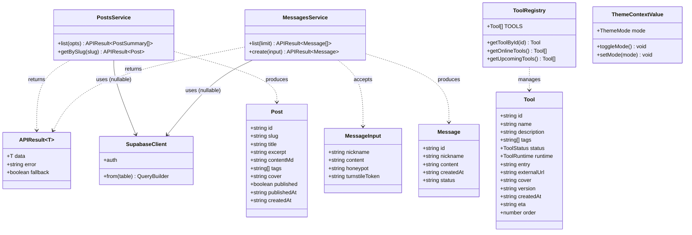
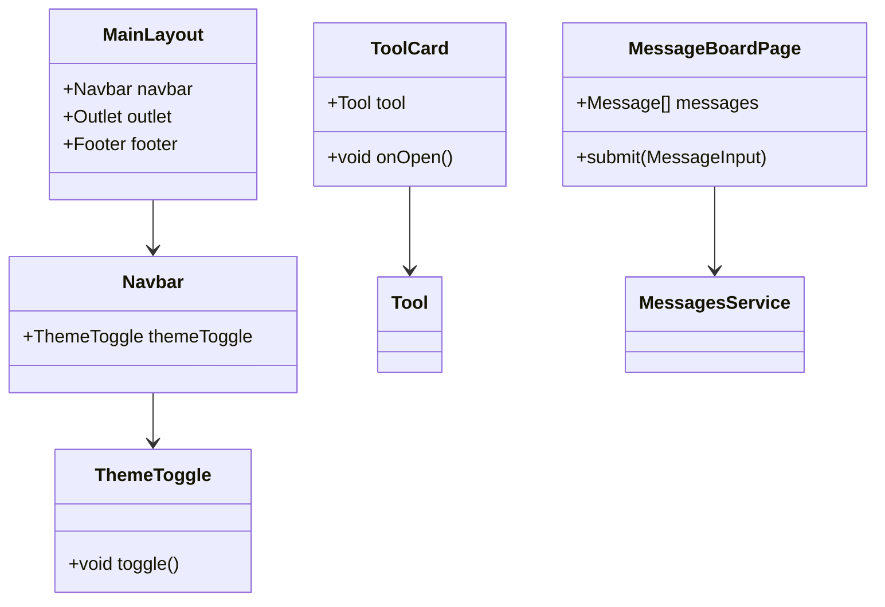
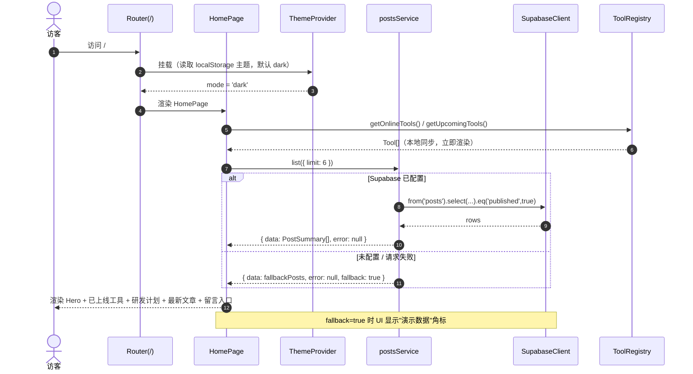
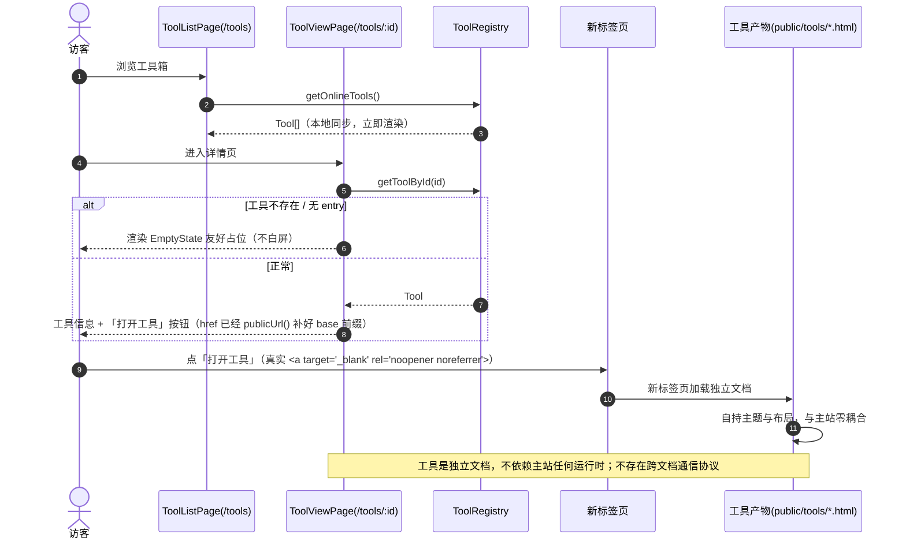
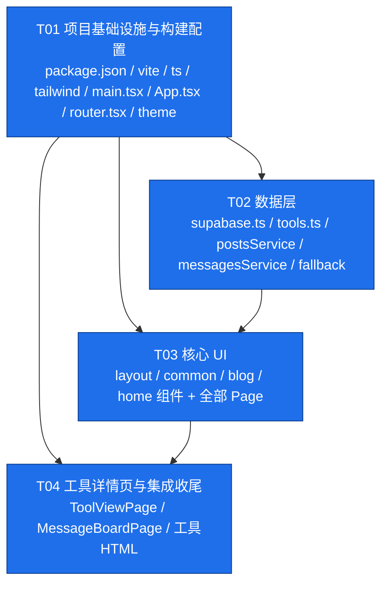

# ARCHITECTURE — bannianjihua_web（百年计划 · 个人站点）

> 架构师：高见远 | 输入：`docs/PRD.md` | 输出目标：可直接交付工程师"照写"的实现蓝图
> 部署约束：**纯静态产物（`dist/`）+ 免费静态托管，无任何服务器端进程**

---

## Part A：系统设计

### 1. 实现方案与框架选型

#### 1.1 核心技术挑战

| # | 挑战 | 应对策略 |
|---|---|---|
| C1 | 纯静态托管下 SPA 深层路由（`/blog/xxx` 直接访问）会 404 | `createBrowserRouter` + Cloudflare Pages `_redirects` 回退；GitHub Pages 用 `404.html` 兜底（见 §1.3） |
| C2 | 工具是"自包含单文件 HTML"，需零改造复用 + 样式隔离 + 离线可跑 | **新标签页直接打开**：单文件放 `public/tools/*.html`，用真实 `<a target="_blank">` 打开（不做同页嵌入，见 §1.3） |
| C3 | 环境变量缺失（未配 Supabase）时不能让整站崩溃 | `isSupabaseConfigured` 守卫 + Service 层本地 fallback 数据，留言板降级为"后端未配置"提示 |
| C4 | 无后端时的留言防滥用 | Honeypot + localStorage 60s 限流 + 长度校验 + 可选 Turnstile 开关（默认关） |
| C5 | 主题（深/浅色）需同时驱动 MUI + Tailwind | 双轨同步：MUI ThemeProvider + `:root` CSS 变量（工具是独立文档、自持主题，不参与同步） |
| C6 | `logic-fallacy-cards` 依赖无头 Chrome 生成 PNG，浏览器端无法实时运行 | 定位为"已生成图集静态展示"，注册表 `runtime: 'light-backend'` 且 `entry` 指向静态图集页（见「待明确事项 Q3」） |

#### 1.2 框架与库选型（锁定版本）

| 类别 | 选型 | 版本 | 理由 |
|---|---|---|---|
| 构建 | **Vite** | `^5.4.10` | 极快冷启动/HMR、原生 ESM、`base` 路径可配（适配 GH Pages 子路径） |
| UI 框架 | **React** | `^18.3.1` | PRD 锁定；生态成熟 |
| 语言 | **TypeScript** | `^5.6.3` | 类型即接口契约，降低跨文件协作成本 |
| 组件库 | **MUI (@mui/material)** | `^5.16.7` | PRD 锁定；提供 ThemeProvider/暗色模式/成熟组件 |
| 样式 | **Tailwind CSS** | `^3.4.14` | PRD 锁定；用 CSS 变量做暗色适配，与 MUI 共存 |
| 路由 | **react-router-dom** | `^6.27.0` | 使用 `createBrowserRouter` 数据路由 API，支持懒加载路由 |
| 数据库 | **@supabase/supabase-js** | `^2.45.4` | 匿名直连 PostgREST，前端仅用 anon key |
| Markdown | **react-markdown** | `^9.0.1` | 文章正文渲染 |
| MD 插件 | **remark-gfm** | `^4.0.0` | 表格/任务列表/删除线等 GFM 语法 |
| 代码高亮 | **rehype-highlight** | `^7.0.0` | 文章内代码块高亮（highlight.js 主题经 CSS 引入） |
| 图标 | **@mui/icons-material** | `^5.16.7` | 与 MUI 版本对齐 |

> **不用**：`@supabase/ssr`、任何 Node 端/SSR 方案、任何常驻服务端进程。全部产物为浏览器可执行的静态文件。

#### 1.3 架构模式与关键决策

- **模式**：分层 SPA —— `pages`（路由页）→ `components`（展示）→ `services`（数据访问）→ `lib`（基础设施）。数据访问统一经 Service，页面不直接调 supabase。
- **状态管理**：当前无需 Redux/Zustand。仅用 React Context 管一件事：**主题 ThemeContext**（含 localStorage 持久化）。全局态极简，避免过度设计。
- **路由方案（C1 落地）**：
  - `src/router.tsx` 使用 `createBrowserRouter`。
  - **主站托管（Cloudflare Pages）**：在 `public/_redirects` 写入：
    ```
    /*  /index.html  200
    ```
    使所有深层路径回退到 SPA 入口，由前端路由接管。
  - **GitHub Pages 兜底**：构建后复制 `dist/index.html` 为 `dist/404.html`（通过 npm script `postbuild` 或 `vite-plugin` 完成），GitHub Pages 命中 404 时返回该页，SPA 重新接管路由。**注意 GH Pages 子路径需在 `vite.config.ts` 设置 `base`。**
- **工具呈现（C2 落地）**：`/tools/:id` 详情页 + 真实 `<a target="_blank" rel="noopener noreferrer">` 新标签页打开静态产物，**不做 iframe 嵌入**（2026-10-11 推翻原方案，见 PRD §6）。
- **降级策略（C3 落地）**：`isSupabaseConfigured` 为 false 时，`postsService`/`messagesService` 返回本地 fallback 数据或"未配置"错误对象，页面优雅提示而不崩溃。

---

### 2. 文件列表及目录树

```
bannianjihua_web/
├── index.html                          # Vite 入口 HTML（挂载 #root）
├── package.json                        # 依赖与脚本（dev/build/preview/postbuild）
├── tsconfig.json                       # TS 主配置（路径别名 @/*）
├── tsconfig.node.json                  # Vite 配置用 TS 配置
├── vite.config.ts                      # Vite 配置（React 插件、base、别名）
├── tailwind.config.ts                  # Tailwind（content 范围 + CSS 变量色板）
├── postcss.config.js                   # PostCSS（tailwind + autoprefixer）
├── .env.example                        # 环境变量样例（VITE_SUPABASE_URL 等）
├── .gitignore
├── docs/                               # 文档（PRD / ARCHITECTURE / 图）
├── public/
│   ├── _redirects                      # Cloudflare Pages SPA 回退（/* /index.html 200）
│   ├── favicon.svg
│   ├── robots.txt
│   └── tools/                          # 自包含工具 HTML（原样放置，零改造）
│       ├── md-to-html-reader.html      # 已上线工具产物
│       ├── english-dict-reader.html    # 已上线工具产物
│       └── logic-fallacy-cards.html    # 逻辑谬误图集静态展示页（见 Q3）
└── src/
    ├── main.tsx                        # 应用入口：挂载 Provider + Router
    ├── router.tsx                      # createBrowserRouter 路由表（懒加载）
    ├── App.tsx                         # 根布局：ThemeProvider + MainLayout + 全局样式
    ├── vite-env.d.ts                   # import.meta.env 类型声明
    ├── types/
    │   └── index.ts                    # 全局 TS 类型：Tool / Post / Message / APIResult
    ├── lib/
    │   ├── supabase.ts                 # Supabase 单例 + isSupabaseConfigured 守卫
    │   ├── theme.ts                    # MUI 主题（light/dark）工厂 + 调色板
    │   └── utils.ts                    # 通用工具（formatDate / uuid / cn 等）
    ├── contexts/
    │   └── ThemeContext.tsx            # 主题上下文：mode / toggleMode / 持久化 + 广播
    ├── services/
    │   ├── postsService.ts             # 文章数据访问（list/getBySlug），含 fallback
    │   └── messagesService.ts          # 留言数据访问（list/create），含限流/降级
    ├── data/
    │   ├── tools.ts                    # 工具注册表（本地静态，唯一真相源）
    │   ├── fallbackPosts.ts            # 本地兜底文章（无 Supabase 时演示）
    │   └── fallbackMessages.ts         # 本地兜底留言（可选，演示用）
    ├── components/
    │   ├── layout/
    │   │   ├── MainLayout.tsx          # 布局壳：Navbar + <Outlet> + Footer
    │   │   ├── Navbar.tsx              # 顶部固定导航 + 主题切换按钮
    │   │   └── Footer.tsx              # 页脚（About / RSS / GitHub / 版权）
    │   ├── common/
    │   │   ├── ThemeToggle.tsx         # 深浅色切换按钮
    │   │   ├── Section.tsx             # 区块容器（标题 + 内容 slot）
    │   │   ├── TagChip.tsx             # 标签 chip
    │   │   ├── StatusBadge.tsx         # 状态徽章（已上线/研发中）
    │   │   ├── EmptyState.tsx          # 空/占位状态
    │   │   └── ErrorState.tsx          # 错误/降级提示（含"后端未配置"文案）
    │   ├── tools/
    │   │   ├── ToolCard.tsx            # 工具卡片（图标/名称/描述/标签/状态/打开）
    │   │   └── ToolFilterBar.tsx       # 工具筛选（状态 + 标签）
    │   ├── blog/
    │   │   ├── PostCard.tsx            # 文章卡片
    │   │   └── MarkdownView.tsx        # react-markdown + remark-gfm + rehype-highlight
    │   └── home/
    │       ├── HeroSection.tsx         # 首页 Hero + CTA + 统计
    │       ├── OnlineToolsSection.tsx  # 已上线工具区
    │       ├── RoadmapSection.tsx      # 研发计划预览区
    │       ├── LatestPostsSection.tsx  # 最新文章区
    │       └── MessageCtaSection.tsx   # 留言入口区（3 条预览）
    ├── pages/
    │   ├── HomePage.tsx                # /
    │   ├── BlogListPage.tsx            # /blog
    │   ├── BlogPostPage.tsx            # /blog/:slug
    │   ├── ToolListPage.tsx            # /tools
    │   ├── ToolViewPage.tsx            # /tools/:id 详情页（信息 + 「打开工具」按钮）
    │   ├── RoadmapPage.tsx             # /roadmap
    │   ├── MessageBoardPage.tsx        # /message（表单 + 列表 + 防滥用）
    │   ├── AboutPage.tsx               # /about
    │   └── NotFoundPage.tsx            # *
    └── styles/
        └── index.css                   # Tailwind 指令 + :root CSS 变量 + hljs 主题 + 全局重置
```

---

### 3. 数据结构与接口

#### 3.1 TypeScript 类型定义（`src/types/index.ts`）

```ts
// ---- 工具 ----
export type ToolStatus = 'online' | 'planned' | 'developing' | 'paused';
export type ToolRuntime = 'client-only' | 'light-backend';

export interface Tool {
  id: string;                 // 唯一标识，路由 /tools/:id
  name: string;
  description: string;
  tags: string[];
  status: ToolStatus;
  runtime: ToolRuntime;       // 默认 'client-only'
  entry?: string;             // 工具产物静态路径（相对 public/，不带前导斜杠），如 tools/xx.html
  externalUrl?: string;       // 外部兜底跳转（新标签）
  cover?: string;
  version?: string;
  createdAt?: string;         // ISO
  eta?: string;               // 研发中预计
  order?: number;
}

// ---- 文章 ----
export interface Post {
  id: string;                 // uuid
  slug: string;               // unique
  title: string;
  excerpt: string;
  contentMd: string;          // 对应 DB content_md
  tags: string[];
  cover?: string;
  published: boolean;
  publishedAt: string;        // ISO
  createdAt: string;          // ISO
}
export type PostSummary = Pick<
  Post, 'id' | 'slug' | 'title' | 'excerpt' | 'tags' | 'cover' | 'publishedAt'
>;

// ---- 留言 ----
export interface Message {
  id: string;
  nickname: string;           // <= 30
  content: string;            // 1..500
  createdAt: string;          // ISO
  status: 'visible' | 'hidden';
}
export interface MessageInput {
  nickname: string;
  content: string;
  honeypot?: string;          // 蜜罐，非空即判机器人
  turnstileToken?: string;    // 可选
}

// ---- 统一返回 ----
export interface APIResult<T> {
  data: T | null;
  error: string | null;
  /** 数据是否来自本地兜底（用于 UI 标注 "演示数据"） */
  fallback?: boolean;
}

// ---- 主题 ----
export type ThemeMode = 'light' | 'dark';
```

#### 3.2 服务与基础设施接口（签名约定）

```ts
// src/lib/supabase.ts
export const supabase: SupabaseClient | null;   // 未配置时为 null
export const isSupabaseConfigured: boolean;

// src/services/postsService.ts
export const postsService: {
  list(opts?: { tag?: string; limit?: number }): Promise<APIResult<PostSummary[]>>;
  getBySlug(slug: string): Promise<APIResult<Post>>;
};

// src/services/messagesService.ts
export const messagesService: {
  list(limit?: number): Promise<APIResult<Message[]>>;
  create(input: MessageInput): Promise<APIResult<Message>>;  // 内部做 honeypot/限流/长度校验
};

// src/data/tools.ts
export const TOOLS: Tool[];
export const getToolById(id: string): Tool | undefined;
export const getOnlineTools(): Tool[];      // status === 'online'
export const getUpcomingTools(): Tool[];    // status in planned|developing|paused

// src/contexts/ThemeContext.tsx
export interface ThemeContextValue {
  mode: ThemeMode;
  toggleMode(): void;
  setMode(m: ThemeMode): void;
}
export const useThemeMode: () => ThemeContextValue;
```

#### 3.3 类图 / 实体关系（Mermaid classDiagram）



#### 3.4 组件与页面的依赖关系（Mermaid classDiagram）



---

### 4. 程序调用流程（Mermaid sequenceDiagram）

#### 4.1 首页加载（含 Supabase 降级分支）



#### 4.2 工具打开流程（新标签页直开）



---

### Part B：任务分解

### 5. 依赖包列表

**dependencies**
```json
{
  "@emotion/react": "^11.13.3",
  "@emotion/styled": "^11.13.0",
  "@mui/material": "^5.16.7",
  "@mui/icons-material": "^5.16.7",
  "@supabase/supabase-js": "^2.45.4",
  "react": "^18.3.1",
  "react-dom": "^18.3.1",
  "react-router-dom": "^6.27.0",
  "react-markdown": "^9.0.1",
  "remark-gfm": "^4.0.0",
  "rehype-highlight": "^7.0.0"
}
```

**devDependencies**
```json
{
  "@types/react": "^18.3.12",
  "@types/react-dom": "^18.3.1",
  "@vitejs/plugin-react": "^4.3.3",
  "autoprefixer": "^10.4.20",
  "postcss": "^8.4.47",
  "tailwindcss": "^3.4.14",
  "typescript": "^5.6.3",
  "vite": "^5.4.10"
}
```

> `package.json` scripts 约定：
> ```json
> {
>   "dev": "vite",
>   "build": "tsc -b && vite build",
>   "postbuild": "node scripts/copy-404.mjs",
>   "preview": "vite preview"
> }
> ```
> `scripts/copy-404.mjs` 复制 `dist/index.html` → `dist/404.html`（GitHub Pages SPA 兜底）。

### 6. 任务列表（按依赖顺序，共 4 个任务）

> **硬约束对齐**：≤5 个任务；每任务 ≥3 文件；T01 为基础设施；禁止把配置分散。

---

#### **T01 — 项目基础设施与构建配置**（优先级 P0，无依赖）

**目标**：搭起可 `npm run dev` 跑通的空壳工程：构建、样式管线、SPA 回退、入口挂载、全局类型、主题基础设施。

**涉及文件**：
| 文件 | 职责 | 关键导出/内容 |
|---|---|---|
| `package.json` | 依赖 + scripts | `dev/build/postbuild/preview`；deps 见 §5 |
| `vite.config.ts` | Vite 配置 | `@vitejs/plugin-react`、`resolve.alias['@']=src`、`base:'/'` |
| `tsconfig.json` / `tsconfig.node.json` | TS 配置 | `paths: {'@/*': ['src/*']}`、strict |
| `tailwind.config.ts` | Tailwind | `content: ['./index.html','./src/**/*.{ts,tsx}']`、`darkMode:'class'`、CSS 变量色板 |
| `postcss.config.js` | PostCSS | tailwind + autoprefixer |
| `index.html` | 入口 HTML | `<div id="root">`、`<script type="module" src="/src/main.tsx">` |
| `.env.example` | 环境样例 | `VITE_SUPABASE_URL` / `VITE_SUPABASE_ANON_KEY` / `VITE_TURNSTILE_SITE_KEY` |
| `.gitignore` | 忽略 | `node_modules`、`dist`、`.env*` |
| `public/_redirects` | CF Pages 回退 | `/*  /index.html  200` |
| `public/favicon.svg` / `public/robots.txt` | 静态资源 | — |
| `scripts/copy-404.mjs` | GH Pages 兜底 | 复制 `dist/index.html`→`dist/404.html`（目录不存在则跳过） |
| `src/main.tsx` | 应用入口 | `createRoot(...).render(<App/>)`，import `styles/index.css` |
| `src/vite-env.d.ts` | env 类型 | `ImportMetaEnv` 声明 |
| `src/types/index.ts` | 全局类型 | §3.1 全部类型 |
| `src/lib/theme.ts` | MUI 主题工厂 | `getTheme(mode)` 返回 light/dark 主题 |
| `src/lib/utils.ts` | 通用工具 | `formatDate(iso)`、`cn(...)`、`safeLocalStorage` |
| `src/contexts/ThemeContext.tsx` | 主题上下文 | `useThemeMode`、持久化 localStorage、默认 `'dark'` |
| `src/styles/index.css` | 全局样式 | Tailwind 三指令 + `:root`/`.dark` CSS 变量 + hljs 主题 |
| `src/App.tsx` | 根组件 | `<ThemeProvider>` + `<CssBaseline>` + `<ThemeModeProvider>` + `<RouterProvider>` |
| `src/router.tsx` | 路由表 | `createBrowserRouter`，懒加载各 page，见 §3.3 路由表 |

**验收**：`npm run dev` 打开 `/` 无报错（页面可为占位）；`npm run build` + `npm run postbuild` 产出 `dist/`（含 `index.html`、`404.html`、`_redirects`）。

---

#### **T02 — 数据层：类型收敛 + 注册表 + 服务 + 兜底数据**（优先级 P0，依赖 T01）

**目标**：完成无 UI 的数据访问与业务数据源，含 Supabase 单例/守卫、工具注册表、文章/留言服务、本地 fallback。

**涉及文件**：
| 文件 | 职责 | 关键导出 |
|---|---|---|
| `src/lib/supabase.ts` | Supabase 单例 + 守卫 | `supabase`（未配置为 `null`）、`isSupabaseConfigured` |
| `src/data/tools.ts` | 工具注册表（唯一真相源） | `TOOLS`、`getToolById`、`getOnlineTools`、`getUpcomingTools` |
| `src/data/fallbackPosts.ts` | 本地兜底文章（2–3 篇常量） | `FALLBACK_POSTS: Post[]` |
| `src/data/fallbackMessages.ts` | 本地兜底留言（演示） | `FALLBACK_MESSAGES: Message[]` |
| `src/services/postsService.ts` | 文章数据访问 + 降级 | `postsService.list/getBySlug` |
| `src/services/messagesService.ts` | 留言数据访问 + 防滥用 + 降级 | `messagesService.list/create` |
| `src/lib/errors.ts` | 统一错误信息常量 | `BACKEND_NOT_CONFIGURED` 等 |

**关键实现要点**：
- `lib/supabase.ts`：
  ```ts
  const url = import.meta.env.VITE_SUPABASE_URL;
  const key = import.meta.env.VITE_SUPABASE_ANON_KEY;
  export const isSupabaseConfigured = Boolean(url && key);
  export const supabase = isSupabaseConfigured
    ? createClient(url, key) : null;
  ```
- 所有 service 方法**先判** `supabase === null` → 直接返回 fallback 数据（`fallback: true`）或 `{ data:null, error: BACKEND_NOT_CONFIGURED }`，**绝不抛异常到组件**。
- `messagesService.create` 内置：honeypot 校验 → localStorage 60s 限流 → 长度校验（content 1–500，nickname ≤30）→ 调 PostgREST insert（`status='visible'`）→ 映射 DB 字段（`content` / `created_at`）。
- 字段映射：DB 用 `content_md`/`created_at`，前端统一 `contentMd`/`createdAt`（在 service 内做 snake↔camel 转换）。
- `data/tools.ts` 初始条目（PRD §8）：`md-to-html-reader`(online)、`english-dict-reader`(online)、`logic-fallacy-cards`(online, runtime:`light-backend`, entry 指向静态图集页)、`set-theory-cards`(planned)。可再补 1–2 条 planned/developing 用于路线图演示。

**验收**：在无 `.env` 情况下 `postsService.list()` 返回 fallback 且不报错；配置 `.env` 后能连 PostgREST（表存在时）。

---

#### **T03 — 核心 UI：布局 + 通用组件 + 页面**（优先级 P0，依赖 T01、T02）

**目标**：实现全部页面与主干组件，完成站点的可见形态与路由闭环。

**涉及文件**：
| 文件 | 职责 |
|---|---|
| `src/components/layout/MainLayout.tsx` | 布局壳 Navbar + Outlet + Footer |
| `src/components/layout/Navbar.tsx` | 固定导航 + 6 项菜单 + ThemeToggle |
| `src/components/layout/Footer.tsx` | 页脚（About/RSS/GitHub/版权） |
| `src/components/common/ThemeToggle.tsx` | 深浅色切换（调用 ThemeContext） |
| `src/components/common/Section.tsx` | 区块容器（标题 + 内容） |
| `src/components/common/TagChip.tsx` | 标签 chip |
| `src/components/common/StatusBadge.tsx` | 状态徽章（已上线/研发中） |
| `src/components/common/EmptyState.tsx` | 空/占位 |
| `src/components/common/ErrorState.tsx` | 错误/降级（含"后端未配置"文案） |
| `src/components/tools/ToolCard.tsx` | 工具卡片 |
| `src/components/tools/ToolFilterBar.tsx` | 状态 + 标签筛选 |
| `src/components/blog/PostCard.tsx` | 文章卡片 |
| `src/components/blog/MarkdownView.tsx` | react-markdown + remark-gfm + rehype-highlight |
| `src/components/home/HeroSection.tsx` | Hero + CTA + 统计 |
| `src/components/home/OnlineToolsSection.tsx` | 已上线工具区 |
| `src/components/home/RoadmapSection.tsx` | 研发计划预览 |
| `src/components/home/LatestPostsSection.tsx` | 最新文章 |
| `src/components/home/MessageCtaSection.tsx` | 留言入口（3 条预览） |
| `src/pages/HomePage.tsx` | `/` |
| `src/pages/BlogListPage.tsx` | `/blog` |
| `src/pages/BlogPostPage.tsx` | `/blog/:slug` |
| `src/pages/ToolListPage.tsx` | `/tools` |
| `src/pages/RoadmapPage.tsx` | `/roadmap` |
| `src/pages/AboutPage.tsx` | `/about` |
| `src/pages/NotFoundPage.tsx` | `*` |

**关键实现要点**：
- 页面从 `services`/`data` 取数，**不直接**触碰 supabase。
- 首页区块严格按 PRD §7 顺序；统计数字来自 `TOOLS.length` 与文章数。
- `BlogPostPage` 用 `useParams().slug` → `postsService.getBySlug`；找不到 → NotFound 内容。
- 降级态用 `ErrorState`/`EmptyState` 表达，fallback 数据显示"演示数据"角标。

**验收**：所有路由可达、导航可用、深浅色切换生效并持久化、无后端时首页/博客/工具列表均正常渲染。

---

#### **T04 — 工具详情页与集成收尾**（优先级 P0，依赖 T01–T03）

**目标**：实现 `/tools/:id` 详情页 + 留言板页面（防滥用） + 工具占位 HTML + 最终联调。

> 2026-10-11 变更：原计划的 `ToolFrame` iframe 容器与 `lib/postMessage.ts` 协议**已废弃并删除**，
> 改为新标签页直接打开工具产物（见 PRD §6 / 本文 §1.3）。下列文件均不再创建。

**涉及文件**：
| 文件 | 职责 |
|---|---|
| `src/pages/ToolViewPage.tsx` | `/tools/:id` 详情页：查注册表 → 工具信息 + 「打开工具」按钮（真实 `<a target="_blank">`），无 entry 时占位 |
| `src/pages/MessageBoardPage.tsx` | `/message`：表单 + 列表 + honeypot + 限流 + 长度校验 + Turnstile 开关 |
| `public/tools/md-to-html-reader.html` | 工具产物占位（真实产物由老板替换） |
| `public/tools/english-dict-reader.html` | 工具产物占位 |
| `public/tools/logic-fallacy-cards.html` | 逻辑谬误图集静态展示页 |

**关键实现要点**：
- 打开动作一律用真实 `<a href target="_blank" rel="noopener noreferrer">`，**不用 `window.open`**（避免弹窗拦截，保证中键/右键「新标签打开」可用）。
- 工具 URL 必须经 `lib/paths.ts` 的 `publicUrl()` 补部署 base 前缀（GitHub Pages 子路径场景，见 §1.3 C1）。
- `MessageBoardPage`：`turnstile` 由 `VITE_TURNSTILE_SITE_KEY` 是否配置决定是否渲染（默认不渲染 = 关闭）；提交走 `messagesService.create`，成功后刷新列表。

**验收**：全部 `/tools/:id` 可达，且「打开工具」能在新标签页正确打开产物（含子路径部署）；不存在工具显示占位；留言板在无后端时优雅提示、防滥用规则生效。

---

### 7. 共享知识（跨文件约定）

1. **命名规范**
   - 文件：组件/页面/上下文 `PascalCase.tsx`；`lib`/`services`/`data` 用 `camelCase.ts`。
   - 类型：`PascalCase`；常量：`UPPER_SNAKE`（如 `TOOLS`、`FALLBACK_POSTS`）；函数/变量 `camelCase`。
   - 导入别名：统一 `@/` → `src/`。

2. **主题变量（CSS 变量 + Tailwind）**
   - `:root` 定义亮色，`.dark` 覆盖深色；变量示例：`--bg`、`--fg`、`--muted`、`--card`、`--border`、`--primary`。
   - Tailwind 通过 `theme.extend.colors` 映射到 `rgb(var(--xxx))` 或直接 `var(--xxx)`，实现"一份 class 双主题"。
   - MUI 主题：`lib/theme.ts` 的 `getTheme(mode)`，`App.tsx` 依据 `ThemeContext.mode` 切换。
   - **默认深色**（老板 IDE 为 dark）；`localStorage` key：`bannianjihua:theme`。

3. **Supabase 客户端单例**
   - 仅在 `src/lib/supabase.ts` 创建一次；**任何组件/service 不得自行 `createClient`**。
   - 读取 `import.meta.env.VITE_SUPABASE_URL` / `VITE_SUPABASE_ANON_KEY`。
   - `isSupabaseConfigured` 为唯一降级开关；未配置时 `supabase === null`。

4. **工具注册表约定**
   - `src/data/tools.ts` 是工具的唯一真相源（P0 不走 Supabase）。
   - `status==='online'` → 已上线；`planned|developing|paused` → 研发中。
   - `runtime` 默认 `'client-only'`；依赖非浏览器能力的标 `'light-backend'`。
   - `entry` 为 `public/` 下静态路径（以 `/tools/` 开头）；`externalUrl` 作兜底跳转。

5. **工具呈现约定**
   - 工具产物是**完全独立的文档**，放 `public/tools/`，用真实 `<a target="_blank" rel="noopener noreferrer">` 打开。
   - 工具 URL **一律经 `lib/paths.ts` 的 `publicUrl()` 构造**，不要手拼 base 前缀（子路径部署会断链）。
   - **不做 iframe 嵌入，也不存在跨文档 postMessage 协议**（2026-10-11 起废弃并删除代码）。
   - 多文件工具（带素材/数据/音轨）走镜像同步脚本：`scripts/sync-daily-english.mjs`，挂在 `prebuild`。

6. **数据访问层约定**
   - 所有 service 返回 `APIResult<T>`：`{ data, error, fallback? }`；**不抛异常**。
   - DB 字段 `snake_case` ↔ 前端 `camelCase` 在 service 内转换。
   - 页面不 import `supabase`，只用 `services` / `data`。

7. **防滥用约定**
   - Honeypot 字段名 `honeypot`（视觉隐藏，非空即丢弃）。
   - 前端限流 localStorage key：`bannianjihua:lastMessageAt`（60s 窗口）。
   - 长度：`content` 1–500，`nickname` ≤30（前端 + DB CHECK 双保险）。
   - Turnstile 由 `VITE_TURNSTILE_SITE_KEY` 是否存在决定启用（默认关闭）。

8. **环境变量**
   - `VITE_SUPABASE_URL`、`VITE_SUPABASE_ANON_KEY`、`VITE_TURNSTILE_SITE_KEY`。
   - 全部可选；缺失时进入降级路径而不是崩溃。

9. **错误文案常量**：统一放 `src/lib/errors.ts`，避免散落字符串。

---

### 8. 待明确事项

| # | 事项 | 当前默认（已按此设计） | 需老板确认 |
|---|---|---|---|
| Q1 | 留言板验证码方案 | P2 先 honeypot + 前端限流 + DB 约束；Turnstile 做成开关默认关 | 是否需要立即启用 Turnstile？site key 是否已有？ |
| Q2 | 工具注册表数据源 | P0 用本地静态 `src/data/tools.ts` | 后续是否要迁移到 Supabase `tools` 表在线维护？ |
| Q3 | **`logic-fallacy-cards` 形态** | 因 PNG 依赖无头 Chrome，定位为"已生成图集静态展示"，`runtime:'light-backend'`，`entry` 指向 `/tools/logic-fallacy-cards.html`（静态图集页） | 是否已有生成好的 PNG 图集可直接放入？还是需要改成别的形态（如外部链接）？ |
| Q4 | 文章内容来源 | 运行时从 Supabase `posts` 拉取；无后端用本地 fallback 演示 | 是否接受首屏文章在无网/无配置时为演示数据？ |
| Q5 | 静态托管平台 | Cloudflare Pages 首选（`_redirects`）；兼容 GitHub Pages（`404.html` + `base`） | 最终选 Cloudflare Pages 还是 GitHub Pages？影响 `base` 与 CI 设置 |
| Q6 | 工具 HTML 真实产物 | 先用占位 HTML 跑通链路（工具是独立文档，无需任何主站协议脚本） | 老板何时提供 `md-to-html-reader.html` / `english-dict-reader.html` 真实文件？ |
| Q7 | SEO/分享（PRD P1） | 本轮未纳入任务（纯静态 SPA 的 meta/sitemap 需额外方案） | 是否需要在本轮加入 sitemap/RSS/OG？ |

---

### 9. 任务依赖图（Mermaid）



> **实现顺序**：T01 → T02 → T03 → T04（T02 与 T03 可并行，但建议串行以保类型先就绪）。工程师需**一次性写完全部文件**，按此顺序可保证依赖始终满足。
